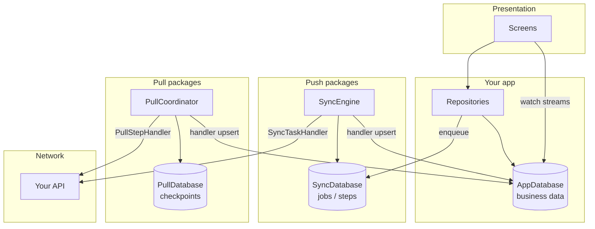

# Architecture

Technical map of how the packages sit beside your app. Vocabulary: [Core concepts](/guide/core-concepts).

## High-level flow



## Component responsibilities

| Piece | Responsibility |
| --- | --- |
| Repository / UI | Enqueue jobs; read App DB for screens |
| `SyncEngine` | Drain outbox; deps; retry; conflicts |
| `SyncDatabase` | Persist jobs/steps |
| `PullCoordinator` | Run features/steps with caps |
| `PullDatabase` | Persist pull checkpoints |
| Your handlers | HTTP + upsert App DB |

## Three databases

Never merge these in documentation or mental model:

| Database | File (default) | Owner | Stores |
| --- | --- | --- | --- |
| **AppDatabase** | `app.sqlite` (your choice) | **Your app** | Documents, orders, settings, … |
| **SyncDatabase** | `sync_core.sqlite` | `flutter_offline_sync_core` | Outbox jobs and steps |
| **PullDatabase** | `flutter_offline_sync_pull.sqlite` | `flutter_offline_sync_pull` | Pull checkpoints only |

Packages **never** open your `AppDatabase`. Handlers you write call your DAOs/local datasources.

## Push lifecycle

```text
JobBuilder.enqueue
  → SyncDatabase (pending)
SyncEngine.syncAll / runJob
  → resolve handlers by taskType
  → execute steps (dependsOn order)
  → success output | failure | conflict
```

## Pull lifecycle

```text
PullCoordinator.runFeature / runAll
  → load/create checkpoint
  → PaginatedListPullStep and/or EntityBatchPullStep
  → handler.fetch → upsert App DB
  → update checkpoint (page, hasMore, status)
```

## Reconnect order

When connectivity returns:

1. **Push** — `await engine.syncAll()` (flush write queue)
2. **Pull** — `await pullCoordinator.runAll()` (or per-feature)

Foreground adapters (`FlutterSyncCoordinator`, `FlutterPullCoordinator`) each listen for connectivity; coordinate order in your app when you run both manually.

## Background Workmanager

One callback can run both:

```dart
await runBackgroundSync(createBackgroundSyncEngine);
await runBackgroundPull(createBackgroundPullCoordinator);
```

Each factory re-opens package DBs at the same paths and rebuilds Dio + registries. See [Foreground & background](/guide/foreground-background).

## Integration boundaries

| Piece | Layer (typical) |
| --- | --- |
| `SyncTaskHandler` / `PullStepHandler` | Data |
| `buildRegistry` / `buildPullRegistry` | App composition / DI |
| `SyncEngine` / `PullCoordinator` | Infrastructure |
| Repositories, App DB | Data |
| Screens / state management | Presentation |

The packages do not require Bloc, Riverpod, or Injectable. See [Clean architecture](/guide/clean-architecture) for a feature-first folder layout.
