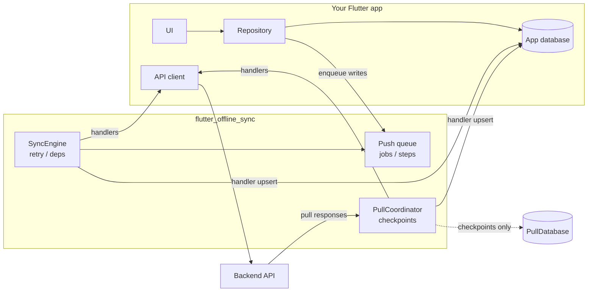

# Introduction

Build offline-first Flutter apps without building your own synchronization infrastructure.

**flutter_offline_sync** helps you queue API writes while offline, retry failed operations, execute dependent tasks in order, and synchronize server data into your local database with resumable pagination.

You control your database, API clients, business logic, and application architecture. The packages handle the synchronization infrastructure.

## What problem does it solve?

Offline sync is hard to get right when you build it yourself. Common pain points:

- Requests fail when the device is offline — and you need a durable queue, not an in-memory list
- Failed operations must retry without duplicating successful side effects
- Multi-step flows need order — upload a file, then create a record with the returned URL
- Server lists need pagination, resume after interruption, and a place to store progress
- Sync should run in the foreground (when connectivity returns) and optionally in the background (Workmanager)

A flat “pending requests” table handles simple POST retries, but cannot express **“run B only after A succeeds, using A’s response.”** Folding sync metadata into your business tables also mixes concerns that belong apart.

## Push vs Pull

Use a simple mental model:

| Direction | Meaning | Typical use |
| --- | --- | --- |
| **Push** | Local changes → server | Create/update while offline, upload files, submit forms, dependent API calls, retry failures |
| **Pull** | Server → local database | Paginated lists, detail batches, save progress (checkpoints), resume interrupted downloads |

**You may need Push only, Pull only, or both.** See [Choosing Push or Pull](/guide/choosing-packages).

## What you still own

flutter_offline_sync does **not** replace:

| You own | Packages own |
| --- | --- |
| App database (Drift or other) | `SyncDatabase` (outbox jobs/steps) |
| Dio / HTTP client and auth | When handlers run (engine / coordinator) |
| Domain models and repositories | Dependency order, retry, conflict pause |
| Business validation and UI | Pull checkpoints (`PullDatabase`) |
| How rows look on screen | Optional job-status widgets (`flutter_offline_sync_ui`) |

Handlers you write bridge the two worlds: the package calls your handler → you call the API → you upsert into **your** App DB.

## Feature overview

| Capability | Package |
| --- | --- |
| Job/step write queue, `SyncEngine`, partial retry, conflicts | `flutter_offline_sync_core` |
| Connectivity + Workmanager for push (re-exports core) | `flutter_offline_sync_push` |
| Paginated / batch pull, checkpoints, `PullCoordinator` | `flutter_offline_sync_pull` |
| Connectivity + Workmanager for pull (re-exports pull) | `flutter_offline_sync_pull_flutter` |
| Badges, banners, job list tiles | `flutter_offline_sync_ui` (optional) |

Most Flutter apps depend on **`flutter_offline_sync_push`** and/or **`flutter_offline_sync_pull_flutter`** — they re-export the core packages.

## When to use it

**Good fit**

- Offline writes with optional multi-step API flows
- Paginated server → device sync with resume
- Apps that already have (or plan) a local DB + HTTP client

**Not a fit**

- Real-time-only apps with no local persistence
- A single fire-and-forget POST with no queue needs (a tiny outbox may be enough)
- Replacing your entire data layer — these packages sit **beside** your App DB

## Next steps

1. [Installation](/guide/installation) — add the right packages  
2. [Quick Start](/guide/quick-start) — enqueue and sync one write end-to-end  
3. [Core concepts](/guide/core-concepts) — jobs, steps, handlers, checkpoints  
4. [Offline Notes example](/examples/) — full push + pull + UI sample app  
