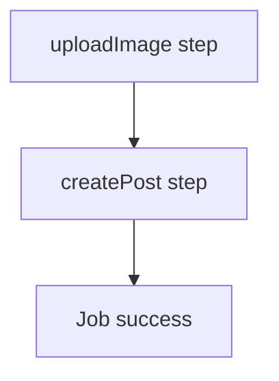

# Push (write queue)

**Push** queues local writes and sends them to your API when the device can reach the network.

If you only need a single enqueue → sync walkthrough, start with [Quick Start](/guide/quick-start). This page goes deeper.

## What Push does

1. Your repository calls `JobBuilder.enqueue()` → job/steps land in **SyncDatabase**
2. Later, `SyncEngine.syncAll()` (or connectivity / Workmanager) runs handlers
3. Handlers call **your** API and optionally upsert **your AppDatabase**
4. Failures can retry; conflicts pause for your UI; successful step outputs feed dependents

## When to use it

- Creating/updating records offline
- Uploading files before a dependent create
- Retrying transient network/server errors
- Showing per-screen pending job UI

## Simple example (one step)

```dart
import 'package:flutter_offline_sync_push/flutter_offline_sync_push.dart';

final registry = SyncHandlerRegistry()
  ..register('createTask', const CreateTaskHandler());

final syncDb = SyncDatabase();
final engine = SyncEngine(db: syncDb, registry: registry);

await JobBuilder(
  syncDb,
  feature: 'tasks',
  screen: 'create_task_screen',
  meta: {'label': 'Create task'},
)
    .addStep(
      'createTask',
      taskType: 'createTask',
      input: {'title': 'Buy milk'},
    )
    .enqueue();

await engine.syncAll();
```

## Multi-step jobs (dependencies)



```dart
await JobBuilder(syncDb, feature: 'posts', screen: 'create_post_screen')
    .addStep(
      'uploadImage',
      taskType: 'uploadImage',
      input: {'filePath': path},
    )
    .addStep(
      'createPost',
      taskType: 'createPost',
      input: {'title': title},
      dependsOn: ['uploadImage'],
    )
    .enqueue();
```

Downstream handler:

```dart
class CreatePostHandler extends SyncTaskHandler {
  const CreatePostHandler(this.dio);
  final Dio dio; // from package:dio — your dependency

  @override
  Future<SyncStepResult> execute(SyncContext ctx) async {
    final imageUrl = ctx.dependencyOutput('uploadImage')['imageUrl'] as String;
    final title = ctx.input['title'] as String;
    final resp = await dio.post('/posts', data: {
      'title': title,
      'imageUrl': imageUrl,
    });
    return SyncStepResult.success({'postId': resp.data['id']});
  }
}
```

`dependsOn` step keys must be added **before** the dependent step in the same `JobBuilder`.

::: tip Cross-job dependencies
Related jobs can wait on another job’s step via `externalDependsOn` / `CrossJobDependency` / `FieldMapping`. See the `flutter_offline_sync_core` package README for the full builder example.
:::

## Writing handlers

```dart
class UploadImageHandler extends SyncTaskHandler {
  const UploadImageHandler(this.dio);
  final Dio dio;

  @override
  Future<SyncStepResult> execute(SyncContext ctx) async {
    final path = ctx.input['filePath'] as String;
    final resp = await dio.post(
      '/upload',
      data: FormData.fromMap({
        'file': await MultipartFile.fromFile(path),
      }),
    );
    return SyncStepResult.success({'imageUrl': resp.data['url']});
  }
}
```

Use `ctx.idempotencyKey` on requests when your API supports idempotent creates.

### Results

| Result | Meaning |
| --- | --- |
| `SyncStepResult.success(output)` | Step complete; `output` stored for dependents |
| `SyncStepResult.failure(error, {retryable})` | Failed; if `retryable` (default `true`), later `syncAll` may requeue |
| `SyncStepResult.conflict(serverState)` | Job paused until `resolveConflict` |

Override `isOutputStillValid(output, completedAt)` when a successful step’s output can expire (for example a short-lived upload URL).

## Execution lifecycle

```text
enqueue → pending
syncAll → running steps in dependency order
       → success | failure | conflict
retryJob → reset failed steps, re-run (successful valid steps skipped)
```

`recoverInterruptedWork()` resets steps left `running` after a process kill. `FlutterSyncCoordinator.startForegroundSync()` calls this for you.

## Partial retry

```dart
await engine.retryJob(jobId);
```

Only **failed** steps are reset. Successful steps keep their output unless `isOutputStillValid` returns `false`.

## Conflicts

For 409-style responses, return **conflict**, not failure:

```dart
return SyncStepResult.conflict({'serverTitle': serverTitle});
```

After the user chooses a resolution:

```dart
await engine.resolveConflict(jobId, 'createPost', {
  'title': chosenTitle,
  // …fields stored as the step’s success output
});
```

## Optimistic UI

1. Upsert a local row in **AppDatabase** (pending)
2. `JobBuilder.enqueue()` into **SyncDatabase**
3. On handler success, mark the App DB row synced

Do not store product entities only in SyncDatabase.

## Flutter adapter

[`flutter_offline_sync_push`](/packages/flutter_offline_sync_push) adds:

- `FlutterSyncCoordinator` — startup recovery + connectivity → `syncAll`
- `initBackgroundSync` / `runBackgroundSync` — Workmanager

See [Foreground & background](/guide/foreground-background).

## Package reference

[flutter_offline_sync_core](/packages/flutter_offline_sync_core) · [flutter_offline_sync_push](/packages/flutter_offline_sync_push)
